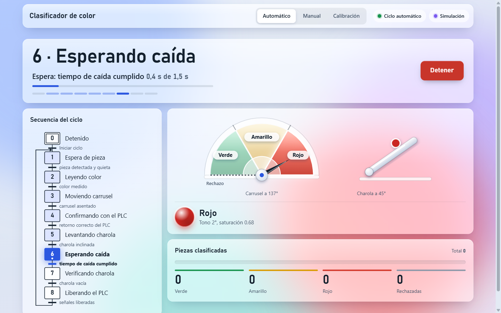
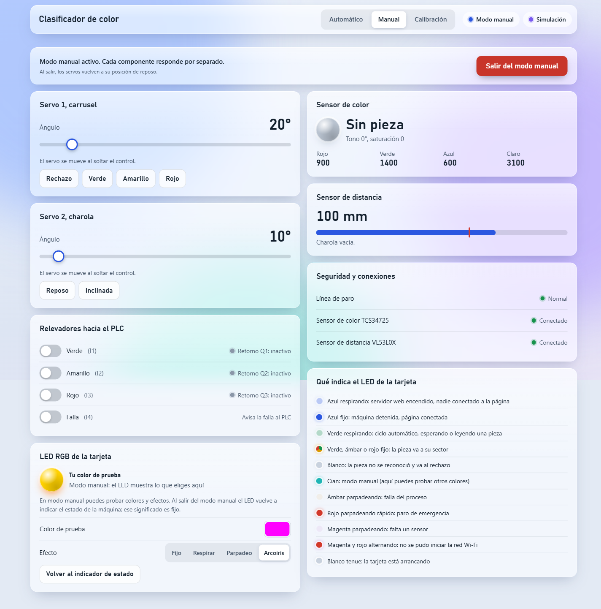

# Clasificador de piezas por color (ESP32-S3 + PLC)

Máquina que clasifica piezas por color (verde, amarillo, rojo y rechazo). Una ESP32-S3 lee el color, mueve un carrusel y una charola con servomotores y confirma cada paso con un PLC Crouzet. La interfaz de operación es una página web servida por la propia ESP32.

Proyecto integrador de Ingeniería en Mecatrónica, Universidad Tecnológica Metropolitana (UTM), Mérida. Proyecto en equipo, en desarrollo (2026).

## Qué hace
- **Ciclo automático por etapas (tipo Grafcet):** espera de pieza → lectura de color → movimiento del carrusel → confirmación con el PLC → caída → verificación → liberación del PLC.
- **Modo manual:** prueba de cada actuador y sensor por separado.
- **Calibración:** parámetros guardados en memoria no volátil, sin recompilar.
- **Seguridad:** paro de emergencia (contacto NC al PLC), detección de pieza atorada y de error de comunicación.
- **Interfaz web:** Wi-Fi propio (modo AP) y WebSocket con estado cada 200 ms; funciona en celular y en laptop, sin internet.

## Hardware
- ESP32-S3 N16R8
- Sensor de color TCS34725 y sensor de distancia VL53L0X (dos buses I²C)
- 2 servomotores (carrusel y charola)
- Módulo de 4 relevadores hacia las entradas del PLC Crouzet (programa en ladder)

## Archivos
| Archivo | Contenido |
|---|---|
| `clasificador.ino` | Firmware: máquina de estados, sensores, servos, PLC, servidor web y WebSocket |
| `config.h` | Pines y red Wi-Fi |
| `ui.html` | Interfaz de operación (fuente) |
| `web_ui.h` | La misma interfaz incrustada en el firmware |
| `diagrama-flujo.png` | Diagrama de flujo del proceso |

## Uso
1. Copia los archivos en una carpeta llamada `clasificador` y ábrela con Arduino IDE (placa *ESP32S3 Dev Module*, PSRAM OPI).
2. Librerías: Adafruit TCS34725, Adafruit VL53L0X, ESP32Servo, ESPAsyncWebServer y AsyncTCP.
3. Cambia `AP_SSID` y `AP_PASS` en `config.h`, carga el sketch, conéctate a esa red y abre `http://192.168.4.1`.

Si abres `ui.html` directo en el navegador, corre una simulación de la máquina sin hardware.
